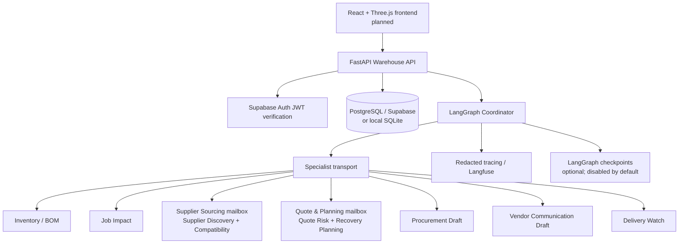

# StockRescue

**Supplier-disruption recovery for industrial repair workshops**

StockRescue is a multi-agent application designed to help industrial repair workshops respond to stock shortages and supplier disruptions. It brings together inventory and bill-of-materials analysis, job-impact assessment, supplier discovery, compatibility checks, quote-risk assessment, recovery planning, procurement preparation, vendor-communication drafting, and delivery monitoring.

The system is designed around a **human-approved, draft-only procurement workflow**. AI agents may analyze information and recommend actions, but deterministic Python rules enforce inventory, compatibility, pricing, budget, feasibility, and approval constraints. StockRescue must not submit purchases or send vendor communications automatically.

> **Project status:** The backend and distributed-agent infrastructure are under active development. Some individual Agentverse request/response exchanges have been verified, but the consolidated eight-identity workflow, full end-to-end scenario, production observability, cloud checkpoint restoration, and frontend remain subject to further implementation and verification. See [Project status](#project-status) before relying on any capability.

---

## Contents

- [Goals](#goals)
- [System architecture](#system-architecture)
- [Agent responsibilities](#agent-responsibilities)
- [Recovery workflow](#recovery-workflow)
- [Technology stack](#technology-stack)
- [Repository layout](#repository-layout)
- [Prerequisites](#prerequisites)
- [Backend setup](#backend-setup)
- [Configuration](#configuration)
- [Run the backend](#run-the-backend)
- [Run Agentverse agents](#run-agentverse-agents)
- [Testing](#testing)
- [Frontend plan](#frontend-plan)
- [API and frontend integration](#api-and-frontend-integration)
- [Security model](#security-model)
- [Database and migrations](#database-and-migrations)
- [Observability and recovery](#observability-and-recovery)
- [Development conventions](#development-conventions)
- [Troubleshooting](#troubleshooting)
- [Project status](#project-status)
- [Roadmap](#roadmap)
- [Contributing](#contributing)

## Goals

StockRescue aims to:

1. Detect material shortages from inventory and BOM requirements.
2. Determine which repair jobs may be affected, based only on available case data.
3. Find candidate suppliers from configured catalogue data and evaluate alternate parts.
4. Evaluate quotes and explicitly surface missing or uncertain costs and delivery information.
5. Generate a recovery plan only when deterministic constraints support it.
6. Require a valid, persisted, human authorization before representing procurement as approved.
7. Prepare purchase-order and vendor-communication drafts without causing external commercial side effects.
8. Track delivery events while treating absent or unconfirmed information as unknown.
9. Preserve a traceable workflow across local tools, remote agent messages, API operations, and database persistence.

## System architecture



### Core design principles

- **Deterministic business rules:** Inventory quantities, BOM requirements, compatibility decisions, cost arithmetic, budget checks, and plan feasibility belong in validated Python code. An LLM is not an authority for these decisions.
- **Agents have bounded responsibilities:** Each specialist accepts only explicitly permitted task types and validated payloads.
- **Remote failure is not success:** In Agentverse mode, missing destinations, unavailable agents, malformed responses, timeout, or correlation mismatch must block the relevant workflow stage. Remote mode must not silently fall back to local execution.
- **Unknown stays unknown:** Missing freight, stock, lead time, compatibility, or delivery evidence must not be inferred or invented.
- **Human control over procurement:** A valid approval must refer to the currently persisted plan and its canonical fingerprint. A request-body flag is never proof of approval.
- **Secrets remain server-side:** Database credentials, agent seeds, API keys, and signing secrets must not enter source control, frontend bundles, logs, or traces.

## Agent responsibilities

The logical workflow has nine specialist capabilities plus a coordinator. Agentverse Basic currently limits the project to eight external-agent identities, so the intended deployment consolidates two pairs of specialist capabilities behind shared mailboxes. The business logic and task types remain separate.

| Agent identity | Logical responsibilities | Typical tasks |
|---|---|---|
| Coordinator | Orchestrate the workflow and validate specialist responses | Start recovery, correlate messages, assemble outcome |
| Inventory / BOM | Compare demand with recorded stock | `inventory_bom` |
| Job Impact | Assess affected jobs and uncovered demand | `job_impact` |
| Supplier Sourcing | Supplier Discovery and Compatibility on one mailbox | `supplier_discovery`, `compatibility` |
| Quote & Planning | Quote Risk and Recovery Planning on one mailbox | `quote_risk`, `recovery_planner` |
| Procurement | Prepare an approval-checked purchase-order draft | `procurement_draft` |
| Vendor Communication | Prepare a vendor message draft | `vendor_communication_prep` |
| Delivery Watch | Assess verified delivery events | `delivery_watch` |

The consolidated mapping is the intended eight-identity design. Do not assume it is fully implemented until the dispatcher, environment configuration, unit tests, and remote integration tests confirm both shared identities support both task types.

### Message contract

Inter-agent messages use typed request/response models from `agents/protocols/messages.py`. Messages should carry a schema version, message and correlation identifiers, workflow and trace IDs, logical sender/recipient, task type, timestamps/deadline, and bounded payload. Responses must be validated against the request and the expected domain result before the coordinator uses them.

## Recovery workflow

The intended workflow is:

1. Load a persisted disruption case.
2. Assess inventory and BOM requirements.
3. Assess the impact on jobs and deadlines.
4. Discover candidate suppliers.
5. Check alternate-part compatibility.
6. Evaluate quotes, commercial risk, and missing information.
7. Determine whether a recovery plan satisfies verified constraints.
8. Prepare vendor communication drafts when needed.
9. Assess available delivery events and report uncertain status honestly.
10. Require an authorized human approval tied to the exact persisted plan before preparing an approval-dependent procurement draft.
11. Persist the relevant case, plan, approval, audit information, and workflow state using the configured repository/checkpoint mechanism.

Some stages have data dependencies. For example, Compatibility needs valid supplier-discovery results; Job Impact needs the relevant case and inventory findings. If a required remote result is absent or invalid, dependent stages must be marked blocked instead of fabricating input.

## Technology stack

### Backend

- Python 3.11 (the development environment used for this project)
- FastAPI and Pydantic for HTTP APIs and validation
- LangGraph for workflow orchestration
- LangChain and ASI:One integration for bounded intent interpretation where configured
- Fetch.ai uAgents and Agentverse mailboxes for distributed task messaging
- PostgreSQL for shared/persistent deployments; SQLite for local development and tests
- Supabase Auth for user authentication and JWT verification
- Langfuse Cloud and local redaction/tracing utilities where configured
- Pytest for unit, repository, API, workflow, and integration tests

### Frontend (planned)

The planned interface uses React, Vite, TypeScript or JavaScript according to the final project setup, Tailwind CSS, and Three.js (typically through React Three Fiber if adopted). The actual frontend package and dependencies must be checked before implementation; this README does not claim that frontend source code already exists.

## Repository layout

The layout below describes the backend structure observed during development. Files may evolve; inspect the repository before adding or renaming modules.

```text
stockrescue/
├── README.md
├── backend/
│   ├── .env.example
│   ├── requirements.txt
│   ├── agents/
│   │   ├── coordinator/
│   │   │   ├── agent.py
│   │   │   ├── agentverse_entry.py
│   │   │   └── langgraph_workflow.py
│   │   ├── inventory_bom/
│   │   ├── job_impact/
│   │   ├── supplier_discovery/
│   │   ├── compatibility/
│   │   ├── quote_risk/
│   │   ├── recovery_planner/
│   │   ├── procurement/
│   │   ├── vendor_voice/
│   │   ├── delivery_watch/
│   │   └── protocols/
│   ├── observability/
│   ├── scripts/
│   │   ├── migrate_sqlite_to_postgres.py
│   │   ├── smoke_test_agentverse.py
│   │   └── smoke_test_job_impact_agentverse.py
│   ├── services/
│   │   ├── intent/
│   │   └── warehouse_api/
│   │       ├── main.py
│   │       ├── auth.py
│   │       ├── schemas.py
│   │       ├── repository.py
│   │       └── postgres_repository.py
│   ├── shared/
│   │   ├── agent_contracts.py
│   │   ├── checkpointing.py
│   │   ├── config.py
│   │   ├── models.py
│   │   └── state_machine.py
│   ├── tools/
│   └── tests/
└── frontend/                 # planned; verify before implementation
```

## Prerequisites

- Windows with PowerShell is the current development environment; Linux/macOS equivalents may be used with adjusted commands.
- Python 3.11 and `pip`.
- Git.
- Access to a PostgreSQL database for PostgreSQL integration tests or a configured local SQLite database for basic development.
- A Supabase project if using Supabase Auth or cloud PostgreSQL.
- An Agentverse account if using real distributed mailbox execution.
- Optional: Langfuse project credentials for cloud tracing.
- Frontend tooling (Node.js and npm) will be required when frontend development begins.

## Backend setup

Run commands from the repository's `backend` directory.

### 1. Create a virtual environment

```powershell
cd C:\agent\stockrescue\backend
py -3.11 -m venv .venv
.\.venv\Scripts\Activate.ps1
python -m pip install --upgrade pip
```

If PowerShell blocks activation, use the project's interpreter directly instead of changing machine-wide execution policy:

```powershell
.\.venv\Scripts\python.exe -m pip install --upgrade pip
```

### 2. Install dependencies

```powershell
.\.venv\Scripts\python.exe -m pip install -r requirements.txt
```

### 3. Configure environment variables

Create a local `.env` file from the template and edit it in your local editor:

```powershell
Copy-Item .env.example .env
code .env
```

If `.env` already exists, do not overwrite it with the template. Update existing entries instead.

### 4. Choose a database backend

For lightweight local development, use SQLite if supported by the current settings. For shared or persistent deployment, configure PostgreSQL:

```dotenv
DATABASE_BACKEND=postgres
WAREHOUSE_DATABASE_URL=postgresql://<user>:<password>@<host>:<port>/<database>
```

Use the connection format provided by your database provider. URL-encode reserved characters in passwords when required by the driver. Never commit an actual connection string.

### 5. Check imports and syntax

```powershell
.\.venv\Scripts\python.exe -m compileall agents shared services tools scripts
```

## Configuration

`backend/.env.example` and `shared/config.py` are the canonical source of truth for setting names and defaults. Keep them synchronized when adding configuration. The following table describes the principal settings; optional settings may be omitted in local development.

| Variable | Purpose | Guidance |
|---|---|---|
| `STOCKRESCUE_ENV` | Runtime environment | Use a development/test value locally; production should fail closed when required configuration is missing. |
| `DATABASE_BACKEND` | Repository selection | `sqlite` for suitable local development; `postgres` for PostgreSQL. Production configuration requires PostgreSQL. |
| `WAREHOUSE_DATABASE_URL` | Warehouse PostgreSQL connection | Secret; set only in local environment or deployment secret manager. |
| `LANGGRAPH_CHECKPOINTS_ENABLED` | Toggle LangGraph persistence | Keep `false` until target-database checkpoint save and restart restoration are verified. |
| `LANGGRAPH_POSTGRES_URL` | Checkpoint database connection | Secret; configure only for verified checkpoint deployments/tests. |
| `DEMO_MODE` | Demo behavior | Review its consequences before production deployment. |
| `REAL_PURCHASING_ENABLED` | Live purchasing safety switch | Keep `false`; no automatic purchasing is part of the MVP. |
| `SPECIALIST_TRANSPORT_MODE` | Local vs remote specialist execution | Use `local` during offline development. Use `agentverse` only after all required destinations, allowlists, remote caller setup, and integration tests pass. |
| `SPECIALIST_TIMEOUT_SECONDS` | Remote specialist timeout | Use a bounded value appropriate to the task; confirm exact configuration names in current settings. |
| `SPECIALIST_MAX_RETRIES` | Retry limit | Keep bounded and retry only transient failures. |
| `AGENTVERSE_SEED_*` | Stable seed for each registered agent identity | Highly sensitive. Never commit, print, or share. Do not regenerate a seed for an existing identity unless intentionally rotating the identity. |
| `AGENTVERSE_*_ADDRESS` | uAgents destination address | Set to the verified address for each live agent identity. Shared specialist roles may intentionally use the same address after consolidation. |
| `AGENTVERSE_CHAT_ALLOWED_SENDERS` | Authorized external callers of coordinator chat | Allowlist; empty must deny all senders. |
| `AGENTVERSE_SPECIALIST_ALLOWED_SENDERS` | Authorized framework senders for specialist tasks | Allowlist actual framework identities; empty must deny all senders. |
| `SUPABASE_URL` | Supabase project URL | Public project URL, but keep project configuration in server settings. |
| `SUPABASE_JWT_ISSUER` | Expected JWT issuer | Must match the Supabase project configuration. |
| `SUPABASE_JWT_AUDIENCE` | Expected JWT audience | Commonly `authenticated`; verify against actual token claims. |
| `SUPABASE_JWT_JWKS_URL` | Trusted public-key endpoint for JWT verification | Must be HTTPS and derived from trusted server-side configuration. |
| `SUPABASE_JWT_ALGORITHMS` | Allowed JWT signing algorithms | Strict allowlist matching the project's active signing method; never allow algorithm fallback on verification failure. |
| `LANGFUSE_ENABLED` and Langfuse credentials | Optional trace export | Keep credentials server-side and redact sensitive data before exporting traces. |

### Agentverse identity consolidation

The intended eight-identity configuration maps two pairs of logical tasks to shared addresses:

```dotenv
# Supplier Discovery and Compatibility use the same mailbox identity after consolidation.
AGENTVERSE_SUPPLIER_DISCOVERY_ADDRESS=<verified-supplier-sourcing-agent-address>
AGENTVERSE_COMPATIBILITY_ADDRESS=<same-verified-supplier-sourcing-agent-address>

# Quote Risk and Recovery Planning use the same mailbox identity after consolidation.
AGENTVERSE_QUOTE_RISK_ADDRESS=<verified-quote-planning-agent-address>
AGENTVERSE_RECOVERY_PLANNER_ADDRESS=<same-verified-quote-planning-agent-address>
```

Do not use these mappings until the dispatchers explicitly permit both task types and tests prove the response schemas remain distinct.

## Run the backend

Start the Warehouse API in a terminal:

```powershell
cd C:\agent\stockrescue\backend
.\.venv\Scripts\python.exe -m uvicorn services.warehouse_api.main:app --host 127.0.0.1 --port 8000 --reload
```

Useful local endpoints:

- Health check: `http://127.0.0.1:8000/health`
- Interactive API schema: `http://127.0.0.1:8000/docs`
- OpenAPI JSON: `http://127.0.0.1:8000/openapi.json`

Use `/docs` and the actual route definitions in `services/warehouse_api/main.py` as the authoritative API contract. Do not assume a route or schema exists merely because it is described in a future plan.

PowerShell health check:

```powershell
Invoke-RestMethod http://127.0.0.1:8000/health
```

A healthy response only means the API process answered; it does not by itself prove the API uses the intended cloud database or that the recovery workflow succeeded.

## Run Agentverse agents

Each unique agent identity must be configured and connected to a mailbox through Agentverse Inspector. Agent processes are separate processes and must remain running while they receive messages. Avoid starting two processes with the same seed/address; they can compete for mailbox envelopes or collide on local ports.

From `backend`, the current entry point pattern is:

```powershell
.\.venv\Scripts\python.exe -m agents.coordinator.agentverse_entry
.\.venv\Scripts\python.exe -m agents.inventory_bom.agentverse_entry
.\.venv\Scripts\python.exe -m agents.job_impact.agentverse_entry
.\.venv\Scripts\python.exe -m agents.supplier_discovery.agentverse_entry
.\.venv\Scripts\python.exe -m agents.quote_risk.agentverse_entry
.\.venv\Scripts\python.exe -m agents.procurement.agentverse_entry
.\.venv\Scripts\python.exe -m agents.vendor_voice.agentverse_entry
.\.venv\Scripts\python.exe -m agents.delivery_watch.agentverse_entry
```

Run one process per identity, usually in its own terminal while developing locally. The consolidated design retains eight identities and merges Compatibility into Supplier Discovery and Recovery Planning into Quote Risk; there is no need to register or start separate Compatibility or Recovery Planner identities after this consolidation is implemented and verified. The logical specialist source modules remain in the codebase.

For each new identity:

1. Configure a unique stable seed locally.
2. Start the agent and note its displayed address.
3. Open the Inspector URL printed by the running agent.
4. Complete **Connect → Mailbox → Finish** if the mailbox has not been created.
5. Confirm mailbox registration success in the terminal and verify the agent in Agentverse.
6. Configure the address in `.env` and the correct fail-closed sender allowlist.
7. Run a real request/response test before relying on the agent in the coordinator workflow.

An Almanac contract funding warning is distinct from mailbox registration. Do not send funds merely to silence that warning unless on-chain registration is explicitly required by the deployment design.

### Smoke tests

Existing smoke-test scripts include:

```powershell
.\.venv\Scripts\python.exe scripts\smoke_test_agentverse.py
.\.venv\Scripts\python.exe scripts\smoke_test_job_impact_agentverse.py
```

Run them only after reviewing their setup requirements. Some scripts start temporary agents; check for active processes sharing the same seed and port before running a smoke test. The consolidated all-specialist smoke test is the intended acceptance test, but do not assume it exists or succeeds until confirmed in the repository and executed against real mailboxes.

## Testing

Run the local test suite:

```powershell
.\.venv\Scripts\python.exe -m pytest tests -p no:cacheprovider
```

For PostgreSQL repository and process-restart tests, configure `STOCKRESCUE_TEST_POSTGRES_URL` to point to the dedicated **local test database** (for this project, `stockrescue_test`) in the same PowerShell session. Do not use the production Supabase database for destructive tests.

Example, with the password replaced locally and never committed or shared:

```powershell
$env:STOCKRESCUE_TEST_POSTGRES_URL = "postgresql://<test-user>:<test-password>@127.0.0.1:5432/stockrescue_test"
.\.venv\Scripts\python.exe -m pytest tests -p no:cacheprovider
```

Run focused tests when changing a component, then execute the full suite after integration changes:

```powershell
.\.venv\Scripts\python.exe -m pytest tests/test_agent_protocols.py -v
.\.venv\Scripts\python.exe -m pytest tests/test_agentverse_transport.py -v
.\.venv\Scripts\python.exe -m pytest tests/test_authenticated_approvals.py -v
.\.venv\Scripts\python.exe -m pytest tests/test_postgres_restart.py -v
```

Only report results from commands that actually ran. Unit tests with mocked transport do not prove live Agentverse communication. A live smoke test must demonstrate that a real remote request was received and that the returned typed response was validated.

## Frontend plan

The frontend has intentionally been deferred until backend APIs and the full recovery workflow are reliable. It should be an operator-facing application, not merely a static 3D demo.

### Planned user experience

1. **Authentication and access:** sign in through Supabase Auth, obtain a session access token, and send it as a Bearer token to protected backend routes. Never embed a Supabase service-role key, PostgreSQL URL, agent seed, or signing secret in browser code.
2. **Operations dashboard:** display current cases, active disruptions, affected work, short-stock parts, recovery status, unresolved risks, and last-updated timestamps.
3. **Interactive 3D warehouse:** represent warehouse zones, shelves, bins, and stock-bearing items in Three.js. Selecting a location or item should open a detail panel sourced from the API. Use clear status colors with accessible text labels; color must not be the sole status indicator.
4. **Disruption workspace:** explain the disruption, required BOM quantity, verified available quantity, shortage, affected jobs, known deadline information, and unknown fields.
5. **Supplier comparison:** show candidates, offered SKUs, compatibility result, quote data, known/unknown freight, lead time, evidence source, and quote-risk flags. Never present unknown data as confirmed.
6. **Recovery-plan comparison:** show the proposed plan, allocation by supplier, total cost/currency, completion estimate where verified, constraints, assumptions, and blockers.
7. **Approval workspace:** show the exact plan version/fingerprint, approver permissions, approved cost ceiling and currency, expiry, audit history, and revoked/expired states. Approval UI must call authenticated backend endpoints; do not treat a frontend button state as authorization.
8. **Procurement drafts:** present the generated draft and its authorization state. The initial release must not submit an order automatically.
9. **Vendor communication drafts:** let authorized users review or copy drafts. Sending external communication remains disabled unless separately implemented and approved.
10. **Delivery monitoring:** show only recorded delivery events and explicitly label missing/unconfirmed status as unknown.
11. **Workflow timeline:** show each specialist's execution mode, status, duration, correlation ID, error code and timestamps, while excluding credentials and sensitive payload data.

### Proposed frontend structure

Adapt to the actual frontend package when it is created; do not add empty files merely to match this proposal.

```text
frontend/
├── package.json
├── vite.config.ts
├── index.html
├── src/
│   ├── app/
│   │   ├── App.tsx
│   │   ├── router.tsx
│   │   └── providers.tsx
│   ├── components/
│   │   ├── layout/
│   │   ├── feedback/
│   │   ├── warehouse3d/
│   │   └── data-display/
│   ├── features/
│   │   ├── auth/
│   │   ├── dashboard/
│   │   ├── inventory/
│   │   ├── disruptions/
│   │   ├── suppliers/
│   │   ├── recovery-plans/
│   │   ├── approvals/
│   │   └── deliveries/
│   ├── hooks/
│   ├── lib/
│   │   ├── api-client.ts
│   │   ├── auth-client.ts
│   │   └── validation.ts
│   ├── types/
│   └── styles/
└── tests/
```

### Frontend engineering requirements

- Use TypeScript where feasible and derive endpoint schemas from the backend OpenAPI contract where practical.
- Keep API access in a centralized typed client rather than scattering `fetch` calls throughout UI components.
- Read the backend base URL from a Vite environment variable such as `VITE_API_BASE_URL`; only public configuration may use the `VITE_` prefix. Never place secrets in frontend environment variables.
- Send the Supabase session's access token as `Authorization: Bearer <token>` for authenticated routes. The backend must independently verify the token and authorization on every protected action.
- Handle loading, empty, stale, error, unauthorized, forbidden, and partial/blocked workflow states.
- Validate untrusted API data at the UI boundary when appropriate.
- Make the 3D warehouse performant: lazy-load the scene, dispose of Three.js resources, support reduced-motion preferences, provide a 2D/list alternative, and ensure keyboard and screen-reader access to important data.
- The frontend must not calculate or override authoritative business decisions. Display backend-validated results and explain uncertainty.
- Do not use mock responses to make production API integrations appear complete. If a mock mode is used during UI development, label it clearly and keep it separate from integration acceptance tests.

### Frontend setup (when implemented)

When a `frontend/` package exists, read its actual `package.json` before installing or running commands. The intended development commands will ordinarily be similar to:

```powershell
cd C:\agent\stockrescue\frontend
npm install
npm run dev
```

The exact scripts depend on the package configuration. Do not claim the frontend is runnable before this package and its source are actually present.

## API and frontend integration

The API is the authoritative contract. Discover routes and schemas from:

- `http://127.0.0.1:8000/docs`
- `http://127.0.0.1:8000/openapi.json`
- `backend/services/warehouse_api/main.py`
- `backend/services/warehouse_api/schemas.py`

Known approval-related routes implemented in the current reported backend include:

- `POST /cases/{case_id}/plans/{plan_id}/approvals` — create an approval; must require a verified procurement-approver/admin identity.
- `POST /cases/{case_id}/plans/{plan_id}/approvals/{approval_id}/revoke` — revoke an approval; must be authenticated and authorized.
- `GET /cases/{case_id}/plans/{plan_id}/approvals` — read approval history, subject to API authentication requirements.
- `GET /cases/{case_id}/plans/{plan_id}/approvals/active` — get the active applicable approval.
- `GET /approvals/{approval_id}` — retrieve an approval.
- `GET /cases/{case_id}/plans/{plan_id}/approvals/audit` — retrieve audit history.

Confirm these routes and their exact request/response models from the running OpenAPI document before implementing frontend calls. The OpenAPI specification takes precedence over this summary if code has changed.

## Security model

- **Authentication:** validate Supabase JWT signatures server-side. The project's active signing key currently reports ES256/ECC P-256; use the trusted JWKS endpoint for asymmetric verification, with an explicit algorithm allowlist, issuer, audience, expiry, and required claims.
- **Authorization:** roles are server-controlled. Never trust a role, actor ID, `approval_verified`, budget ceiling, or approval status supplied by the browser.
- **Procurement approval:** verify the persisted current plan, canonical fingerprint, case, currency, cost ceiling, expiry and revocation state at the server boundary.
- **Database:** use parameterized SQL, least privilege, safe transaction handling, migrations, and non-production databases for destructive tests. RLS is defense in depth; a direct database-owner connection may bypass it, so the API still needs explicit authorization.
- **Agentverse:** validate the framework sender identity against a fail-closed allowlist and validate logical task, recipient, correlation IDs, deadlines and response schemas.
- **External content:** supplier notes, documents, and received messages are untrusted. Prompt injection inside a payload cannot override authorization or deterministic business rules.
- **Secrets:** `.env` must be Git-ignored. Use a secret manager for deployment. Never print or commit seeds, signing secrets, JWTs, database URLs, API keys, or Langfuse secret keys.
- **Safe defaults:** `REAL_PURCHASING_ENABLED=false`; `LANGGRAPH_CHECKPOINTS_ENABLED=false` until cloud save and restoration are independently verified.
- **Logging:** log event type, identifiers, status and duration where safe; redact credentials and avoid dumping raw payloads.

## Database and migrations

Both SQLite and PostgreSQL repository implementations exist. Use the repository factory (`get_repository(settings)`) consistently so the API and coordinator use the same configured backend.

The SQLite-to-PostgreSQL migration script is `backend/scripts/migrate_sqlite_to_postgres.py`. Review its `--help` output before use. Treat dry-run as the default unless the script documentation indicates otherwise, back up the source database, and verify the target rows and schema before switching the API to PostgreSQL.

Do not run migrations or destructive test fixtures against the production Supabase database. PostgreSQL integration tests must use the dedicated local `stockrescue_test` database unless a separately designed, non-destructive cloud verification is explicitly required.

## Observability and recovery

- Use the existing tracing and redaction modules rather than creating parallel logging implementations.
- Langfuse tracing is optional and must fail safely if unavailable.
- Workflow and task IDs should make it possible to correlate the Coordinator with all specialist requests and responses.
- LangGraph checkpointing is a separate concern from warehouse-data persistence. Test serialization and restart restoration before enabling checkpointing in a deployed environment.
- Recovery acceptance must cover blocked outcomes and failures, not just a successful path. A valid `no_feasible_plan` outcome is different from a workflow execution error and should be represented accordingly.

## Development conventions

- Inspect existing model, service, and repository interfaces before adding code.
- Prefer small modules with one responsibility and reuse deterministic specialist functions.
- Keep external I/O behind explicit adapters and test it using unit mocks plus targeted live smoke tests.
- Make message types, allowed task lists, payload validation, timeouts and error codes explicit.
- Never silently fall back from a requested remote call to local execution.
- Keep migrations versioned and test both SQLite and PostgreSQL repository contracts.
- Run focused tests first, then the full suite. Report exact outcomes, including skipped tests and external-service tests not run.
- Update `.env.example`, tests and documentation whenever configuration or public API contracts change.

## Troubleshooting

### Port already in use (`WinError 10048`)

A second process is attempting to bind to a port already used by an agent. Identify the process owning the port, stop the duplicate using its own terminal with `Ctrl+C`, and start only one process per identity/port. Do not immediately kill arbitrary Python processes.

### Agent mailbox not found / mailbox 401

Open the Inspector URL printed by that agent's current startup logs and complete **Connect → Mailbox → Finish**. Each unique identity requires its own mailbox setup. Then review new terminal logs. A historical mailbox message alone does not prove it is currently connected.

### `unrecognized schema digest`

The sender and receiver may have incompatible registered message schemas or a stale process. Stop duplicate/outdated processes, confirm both use the same `TaskRequest`/`TaskResponse` definitions and compatible uAgents versions, restart each process once, and re-run a live smoke test.

### Connection errors to Agentverse

`getaddrinfo failed`, connection timeout, or server disconnect can indicate DNS, network, proxy, or transient service issues. Check general connectivity and Agentverse status, retry within bounds, and do not mark the task as successful while no valid response has been received.

### Almanac insufficient-funds warning

This is distinct from mailbox setup. Mailbox registration and API registration may work without on-chain Almanac registration, depending on the deployment requirements. Do not fund a wallet without confirming that on-chain registration is actually needed.

### Coordinator reads the wrong database

Check `DATABASE_BACKEND` and ensure both the API and coordinator use `get_repository(settings)`. A hard-coded SQLite repository can silently read a separate database while the API uses PostgreSQL.

### Authenticated request rejected

Check the token's issuer, audience, expiry, signing algorithm and `kid`. The backend must use the active Supabase signing method and trusted JWKS configuration. Do not bypass signature checks or lower the algorithm requirements to resolve an error.

## Project status

This status reflects the development information available when this README was drafted. Re-run tests and remote checks after subsequent code changes.

### Reported implemented

- FastAPI Warehouse API and SQLite/PostgreSQL repository implementations.
- LangGraph coordinator and deterministic specialist functions.
- Typed agent message contracts and a specialist transport abstraction.
- Supabase ES256/JWKS token verification implementation and protected procurement approval flows, according to the latest reported test runs.
- Persistent approval/revocation metadata and audit events, according to the implementation report.
- A real Coordinator-to-Inventory/BOM Agentverse mailbox round-trip was reported successful.
- A real Coordinator-to-Job Impact mailbox round-trip was reported successful.

### Must still be verified after the latest changes

- Eight-identity consolidation and shared mailbox handling for Supplier Discovery + Compatibility and Quote Risk + Recovery Planning.
- All nine logical specialist task types invoked remotely through the consolidated eight-identity architecture.
- Live Supplier Discovery and remaining specialist message exchanges.
- A full end-to-end remote Coordinator recovery scenario.
- Delivery-event persistence and end-to-end redaction coverage.
- Langfuse trace visibility against the intended project.
- LangGraph checkpoint save and process-restart restoration against the intended database. Checkpointing remains disabled until verified.
- Real Supabase authentication end-to-end in the current API runtime, not just mocked JWT tests.
- Frontend implementation and API integration.
- Deployment, backup, and recovery procedures.

### Latest reported tests

A prior implementation report claimed `321 passed, 0 failed, 0 skipped` with the isolated local PostgreSQL test database configured. That result predates some subsequent changes and is not a guarantee that the current checkout still passes. Run the suite and record the actual result before merging or deploying.

## Roadmap

1. Finish the eight-identity Agentverse consolidation and test both merged task pairs.
2. Run the consolidated live mailbox suite for all nine logical specialist task types.
3. Finish delivery monitoring, redaction, tracing and checkpoint recovery verification.
4. Run and record the full end-to-end recovery acceptance scenario.
5. Freeze API schemas and OpenAPI contracts for frontend integration.
6. Build the React + Three.js warehouse and operator interface.
7. Complete integration, accessibility, security, deployment and disaster-recovery checks.

## Contributing

Contributions should preserve deterministic business rules and security boundaries. Before submitting a change:

1. Explain the behavior being changed and any assumptions.
2. Add or update unit tests for normal, invalid, and failure paths.
3. Test both repository implementations for persistence changes.
4. Test remote protocol changes against mocks and, when practical, a real mailbox integration.
5. Run the full regression suite against the isolated PostgreSQL test database.
6. Update `.env.example`, API schemas and this README where appropriate.
7. Include the exact commands run and test outcomes in the pull request.

Do not submit secrets, actual customer data, production database dumps, or agent seed values in commits or issue reports.

---

## License

Add the repository's intended license before publishing or accepting external contributions. Until a license is selected and included, do not assume that the repository is open-source licensed for reuse.

